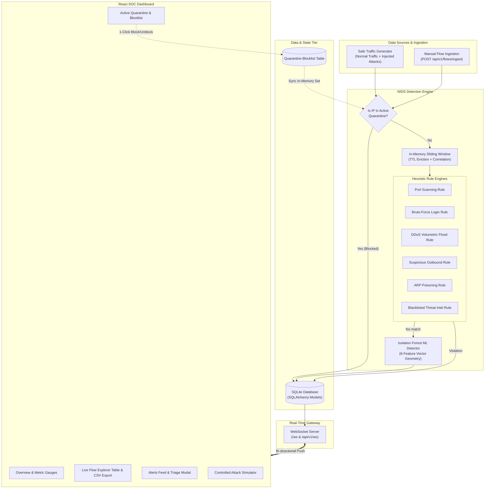

# 🛡️ CYBERDEFEND NIDS — Network Intrusion Detection System

A production-quality, responsive web dashboard and real-time Network Intrusion Detection System (NIDS) designed for SOC analysts. It ingests simulated or live network-flow telemetry, correlates events via in-memory sliding-window heuristics and an unsupervised Scikit-Learn **Isolation Forest** machine learning model, broadcasts detections over WebSockets, and empowers analysts with 1-click active quarantine defense.

---

## 📑 Table of Contents
1. [Architecture Overview](#-architecture-overview)
2. [Tech Stack](#-tech-stack)
3. [Intrusion Detection Engine & Rules](#-intrusion-detection-engine--rules)
4. [Default Credentials](#-default-credentials)
5. [Quick Start & Setup](#-quick-start--setup)
6. [API Endpoints](#-api-endpoints)
7. [Running Tests](#-running-tests)
8. [Docker & Container Setup](#-docker--container-setup)

---

## 🏛️ Architecture Overview



---

## 💻 Tech Stack

| Layer | Technologies |
|---|---|
| **Frontend** | React 18, TypeScript, Vite, Tailwind CSS, Lucide Icons, Recharts |
| **Backend** | Python 3.12, FastAPI, Uvicorn (ASGI), WebSockets |
| **Detection Engine** | In-Memory Sliding-Window State Correlator, Scikit-Learn `IsolationForest` |
| **Database** | SQLite with SQLAlchemy 2.0 ORM models |
| **Security** | Passlib/Bcrypt password hashing, PyJWT JSON Web Tokens, OAuth2 Bearer |
| **Testing** | Pytest, FastAPI TestClient, Starlette |
| **Containerization** | Docker multi-stage build & Docker Compose |

---

## 🔍 Intrusion Detection Engine & Rules

The NIDS engine evaluates every flow against heuristic signatures, sliding-window correlations, and an unsupervised Isolation Forest model:

| Rule Name | Detection Signature / Heuristic | Severity | Risk Score | MITRE / Vector |
|---|---|---|---|---|
| **Port Scanning** | $\ge 5$ distinct destination ports probed by single source IP within 12s window | **High** | 0.85 | Discovery (T1046) |
| **Brute-Force Authentication** | $\ge 4$ rapid connection attempts to authentication ports (22 SSH, 3389 RDP, 21 FTP, 23, 3306, 5432) within 15s | **High** | 0.88 | Credential Access (T1110) |
| **DDoS / Volumetric Flood** | Packet count spike $\ge 400$ pkts or flow count $\ge 25$ from single host within 5s window | **Critical** | 0.95 | Impact / Denial of Service (T1498) |
| **Suspicious Outbound** | Connections targeting known trojan/backdoor ports (4444 Metasploit, 1337, 6667 IRC, 31337 BackOrifice) or exfiltration transfers $\ge 5$ MB | **High / Critical** | 0.82 - 0.88 | Command & Control (T1571), Exfiltration (T1048) |
| **ARP Poisoning (MitM)** | Hardware address conflict: same subnet IP claiming two differing MAC addresses | **Critical** | 0.92 | Man-in-the-Middle (T1557) |
| **Blacklisted Threat Intel** | Bi-directional communication with known C2 botnet relays or Tor exit nodes | **Critical** | 0.98 | Command & Control (T1071) |
| **Isolation Forest Anomaly** | 8-feature vector geometry outlier (duration, packets, bytes, byte-to-packet ratio, port entropy) | **Medium / High** | 0.75 - 0.90 | Statistical Anomaly |

---

## 🔑 Default Credentials

The system automatically initializes and seeds two analyst accounts on first boot:

| Role | Username | Password | Privileges |
|---|---|---|---|
| **SOC Administrator** | `admin` | `CyberDefense2026!` | Full Admin, Settings, Quarantine & Triage |
| **Tier 2 SOC Analyst** | `analyst` | `Analyst2026!` | Investigation, Triage Notes, IP Quarantine |

---

## 🚀 Quick Start & Setup

### Prerequisites
- Python 3.10+
- Node.js 18+ and npm

### 1. Start the Backend API & Engine
```bash
# Navigate to backend directory
cd backend

# Create virtual environment (if not already created)
python -m venv .venv

# Activate virtual environment
# Windows:
.\.venv\Scripts\activate
# Linux/macOS:
# source .venv/bin/activate

# Install dependencies
pip install -r requirements.txt

# Run FastAPI backend with Uvicorn
uvicorn app.main:app --host 127.0.0.1 --port 8000 --reload
```
*The database (`nids.db`) is created and seeded automatically with baseline flows and alerts upon startup!*

### 2. Start the Frontend React Dashboard
```bash
# Open a new terminal and navigate to frontend directory
cd frontend

# Install dependencies
npm install

# Start Vite development server
npm run dev
```

*Open [http://localhost:5173](http://localhost:5173) in your browser.*

---

## 📊 Core Features

1. **Executive SOC Dashboard**:
   - Live metrics: Total Flows, Active Alerts, Blocked IPs, Real-Time Throughput ($Kbps$ & $pps$).
   - Dynamic charts: Traffic & Threat Spikes over Time, Protocol Breakdown, Alert Severity Distribution, Top Communicating Threat Actors.
   - Pulsing WebSocket indicator (`LIVE / ONLINE`) with freeze/resume control.

2. **Network Flow Explorer**:
   - Real-time tabular telemetry stream displaying Source/Target Hosts & Ports, Protocol, Packet/Byte counts, Duration, Classification, Risk Score indicator bar, and Alert Reasons.
   - Multi-factor filtering by IP, Port, Protocol, Classification, and Min Risk Score.
   - 1-Click **CSV Export** for forensic audit logging.

3. **Alerts Feed & Incident Triage Drawer**:
   - Color-coded severity badges (`Critical`, `High`, `Medium`, `Low`).
   - Drill-down investigation modal displaying parsed JSON evidence, detection reasoning, and recommended SOC response.
   - Analyst status workflow (`NEW`, `ACKNOWLEDGED`, `INVESTIGATING`, `RESOLVED`, `FALSE_POSITIVE`) with persistent notes.
   - **1-Click Quarantine**: Instantly block the threat actor IP directly from the alert drawer.

4. **Active IP Quarantine (Firewall Defense)**:
   - Enforces drop action against all subsequent packets involving quarantined hosts.
   - Dedicated management view with 1-click unblock/release capability and manual IP quarantine injection.

5. **Safe Traffic & Intrusion Simulator**:
   - Safe synthetic background flow generator with adjustable rate (0.5 to 10.0 flows/sec) and attack frequency.
   - On-demand injection buttons for all 6 attack vectors with instant visual execution feedback.

---

## 🔌 API Endpoints

### Authentication
- `POST /api/v1/auth/login`: Authenticate and receive JWT bearer token
- `POST /api/v1/auth/token`: OAuth2 password form authentication
- `GET /api/v1/auth/me`: Retrieve current logged-in analyst profile

### Dashboard Analytics
- `GET /api/v1/dashboard/metrics`: High-level flow, alert, throughput, and system health counts
- `GET /api/v1/dashboard/charts`: Aggregated time-series, protocol distribution, and top threat actors

### Flow Ingestion & Telemetry
- `GET /api/v1/flows`: Paginated, filtered, and sorted flow records
- `GET /api/v1/flows/export`: CSV export streaming
- `POST /api/v1/flows/ingest`: Ingest external or custom flow records

### Security Alerts
- `GET /api/v1/alerts`: Paginated security alert feed
- `GET /api/v1/alerts/{id}`: Full detail and raw JSON evidence of an alert
- `PATCH /api/v1/alerts/{id}`: Update alert status and analyst investigation notes
- `POST /api/v1/alerts/{id}/quarantine`: Quarantine source host of the alert

### Active Defense & Quarantine
- `GET /api/v1/quarantine`: List all currently quarantined IPs
- `POST /api/v1/quarantine`: Manually add an IP to the active quarantine blocklist
- `DELETE /api/v1/quarantine/{ip}`: Release an IP from quarantine

### Traffic Simulator
- `GET /api/v1/simulation/status`: Current simulation metrics and settings
- `POST /api/v1/simulation/start`: Activate background traffic simulator
- `POST /api/v1/simulation/stop`: Deactivate background traffic simulator
- `POST /api/v1/simulation/configure`: Configure generation rate and attack probability
- `POST /api/v1/simulation/trigger`: Execute specific attack vector (`port_scan`, `brute_force`, `ddos_flood`, `suspicious_outbound`, `arp_spoof`, `blacklist_comm`)

### Real-Time WebSocket
- `WS /ws` or `WS /api/v1/ws`: Bi-directional stream emitting `FLOW` and `ALERT` events

---

## 🧪 Running Tests

The test suite covers rule logic, ML model scoring, and all REST endpoints:

```bash
cd backend
.\.venv\Scripts\pytest -v
```

All 14 unit and integration tests pass:
- `test_port_scan_detection` (PASSED)
- `test_brute_force_detection` (PASSED)
- `test_ddos_flood_detection` (PASSED)
- `test_suspicious_traffic_detection` (PASSED)
- `test_arp_spoof_detection` (PASSED)
- `test_blacklist_detection` (PASSED)
- `test_ml_anomaly_detector_scoring` (PASSED)
- `test_health_endpoint` (PASSED)
- `test_auth_login_and_token` (PASSED)
- `test_dashboard_metrics_and_charts` (PASSED)
- `test_flows_query_and_export` (PASSED)
- `test_alerts_query_and_patch` (PASSED)
- `test_quarantine_block_and_unblock` (PASSED)
- `test_simulation_trigger` (PASSED)

---

## 🐳 Docker & Container Setup

To run the complete NIDS stack in Docker:

```bash
docker-compose up --build
```
Access the web dashboard at `http://localhost:8000`.
